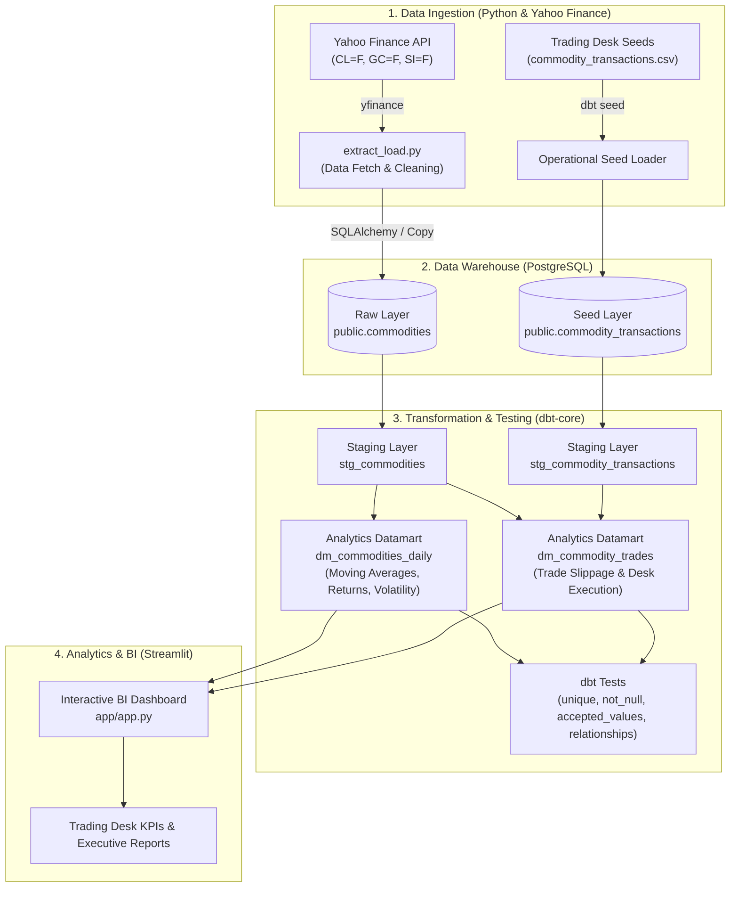

# Commodities Data Warehouse & Analytics Platform

[](https://www.python.org/)
[](https://www.getdbt.com/)
[](https://www.postgresql.org/)
[](https://streamlit.io/)
[](https://www.docker.com/)

An end-to-end modern **ELT (Extract, Load, Transform)** data platform designed for financial commodities analytics (Crude Oil, Gold, Silver). The platform ingests financial market feeds, loads raw records into a PostgreSQL Data Warehouse, executes layered dimensional modeling and quality tests via **dbt (data build tool)**, and serves analytics through an interactive **Streamlit** dashboard.

> **Orchestration:** Scheduled execution, failure alerting, and dependency management for this pipeline are driven by the companion [Airflow Data Orchestrator](https://github.com/mksouzza/modern-stack) project.

---

## Architecture Overview



---

## Data Modeling & Dimensional Architecture

The Data Warehouse follows standard dimensional design and modern layered data modeling:

| Layer | Model / Table | Materialization | Purpose |
| :--- | :--- | :--- | :--- |
| **Raw** | `public.commodities` | Table | Direct landing of daily OHLCV market feeds from Yahoo Finance. |
| **Seeds** | `public.commodity_transactions` | Table | Operational buy/sell orders executed by institutional trading desks. |
| **Staging** | `staging.stg_commodities` | View | Standardizes column types, casts dates, formats names, and handles nulls. |
| **Staging** | `staging.stg_commodity_transactions` | View | Sanitizes trading orders, enforces action constraints (`BUY`/`SELL`). |
| **Analytics** | `analytics.dm_commodities_daily` | Table | Computes analytical metrics: 7-day and 30-day SMAs, daily variance, and return percentages. |
| **Analytics** | `analytics.dm_commodity_trades` | Table | Enriches trading orders with official closing prices to analyze execution slippage. |
| **Reporting** | `analytics.commodities_rep` | View | Curated reporting view for fast BI queries and metric aggregation. |

---

## Data Governance & Testing

Data quality gates are integrated into the pipeline using dbt test suites:
- **Primary Key Integrity:** `unique` and `not_null` assertions on `transaction_id` and composite date/symbol keys.
- **Domain Constraints:** `accepted_values` validation on order directions (`BUY`, `SELL`).
- **Data Completeness:** Enforces valid prices (`close_price > 0`) across all tracked commodities.

---

## Repository Structure

```plaintext
open-dw-workshop/
├── app/
│   └── app.py                      # Streamlit interactive analytics dashboard
├── dw_workshop/                    # dbt project root
│   ├── dbt_project.yml             # dbt configurations and schema materializations
│   ├── profiles.yml.example        # Reference database connection profile
│   ├── models/
│   │   ├── schema.yml              # Source and staging documentation + tests
│   │   ├── staging/
│   │   │   ├── stg_commodities.sql
│   │   │   └── stg_commodity_transactions.sql
│   │   └── analytics/
│   │       ├── schema.yml          # Datamart documentation + tests
│   │       ├── dm_commodities_daily.sql
│   │       ├── dm_commodity_trades.sql
│   │       └── commodities_rep.sql
│   └── seeds/
│       └── commodity_transactions.csv  # Trade desk execution orders
├── src/
│   └── extract_load.py             # Python EL script (Yahoo Finance -> PostgreSQL)
├── docker-compose.yml              # PostgreSQL 15 local infrastructure
├── requirements.txt                # Production Python dependencies
├── .env.example                    # Template for database credentials
└── README.md                       # Project documentation
```

---

## Quickstart Guide

### 1. Prerequisites
- Python 3.10+
- Docker & Docker Compose (optional, for local PostgreSQL)

### 2. Environment Setup
```bash
# Clone repository
git clone https://github.com/mksouzza/open-dw-workshop.git
cd open-dw-workshop

# Create and activate virtual environment
python3 -m venv .venv
source .venv/bin/activate

# Install dependencies
pip install -r requirements.txt

# Configure environment variables
cp .env.example .env
```

### 3. Launch Local Database (Docker)
```bash
docker compose up -d
```

### 4. Execute Extraction & Ingestion Pipeline
```bash
python src/extract_load.py
```

### 5. Run dbt Transformations & Data Tests
```bash
cd dw_workshop

# Set profile directory and run models
export DBT_PROFILES_DIR=.
dbt seed
dbt run
dbt test
```

### 6. Launch the Analytics Dashboard
```bash
cd ..
streamlit run app/app.py
```
Open your browser at `http://localhost:8501` to explore the dashboard.

---

## Engineering Highlights
- **Idempotent Ingestion:** Safe to rerun daily; handles missing or duplicate records gracefully.
- **Windowed Financial Analytics:** Uses window functions (`lag`, moving averages) directly in SQL for high-performance transformations.
- **Separation of Concerns:** Clear boundaries between raw ingestion, model transformation, and BI consumption.
- **Production Ready:** Environment configuration separated from code, reproducible Docker setup, and complete test coverage.


---

## Data Engineering Portfolio Ecosystem

This project is part of a comprehensive three-pillar Data Engineering portfolio:

1. **[Commodities Data Warehouse & Analytics Platform](https://github.com/mksouzza/open-dw-workshop)** (Current Project): Batch ELT, dimensional modeling, dbt-core, PostgreSQL, and Streamlit.
2. **[Real-Time Omnichannel Messaging Lakehouse](https://github.com/mksouzza/realtime-messaging-lakehouse)**: Real-time streaming, Medallion Lakehouse, PySpark, Delta Lake, and GCP Terraform.
3. **[Airflow Data Pipeline Orchestrator](https://github.com/mksouzza/modern-stack)**: Central workflow orchestration, TaskFlow API, failure alerts, SLA monitoring, and Astro CLI.
